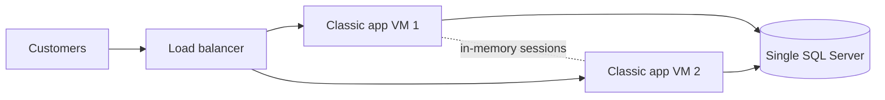
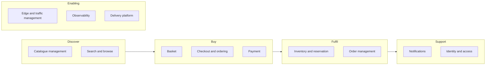
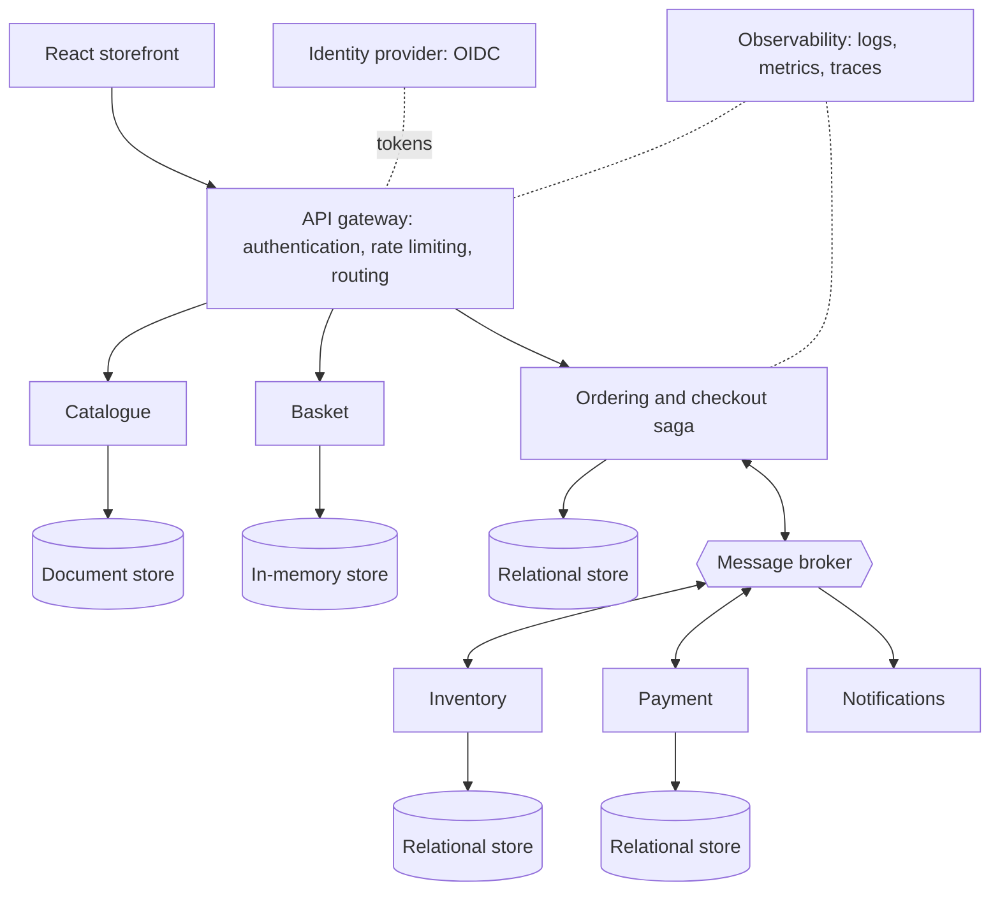

# A3: Architecture Vision

| Field | Value |
|---|---|
| Phase | A |
| Version | 1.0 (Approved 2026-10-24) |
| Date | 2026-10-24 |
| Owner | Lead Architect |
| Inputs | A1 Request, P1 Principles |

> Fictional case study. Business figures are **assumptions** to be validated; they are marked `[assumed]` where they drive design.

## 1. Purpose
Create a shared, concise picture of what the new platform must achieve and why, so stakeholders can approve the direction before detailed architecture work begins.

## 2. Problem statement
ShopStream's monolith, **ShopStream Classic** (baseline, `[assumed]`), is one .NET web application on two virtual machines with a single SQL Server database and in-memory sessions. Observed problems:

1. **Peaks cause outages.** Flash sales saturate the single database; browsing and checkout fail together.
2. **Overselling and duplicate charges.** Stock and payment updates are not coordinated safely under contention or retries.
3. **Slow change.** Any release redeploys everything, so releases are infrequent and risky.
4. **Weak visibility.** Failures are found by customers, not by monitoring.
5. **Compliance burden.** Payment handling touches too much of the system.

## 3. Business drivers, goals and objectives

### 3.1 Drivers

| ID | Driver |
|---|---|
| D1 | Revenue growth through campaigns and flash sales, which create extreme short peaks |
| D2 | Customer trust: no overselling, no double charging, accurate order status |
| D3 | Speed of change: faster, safer releases of individual capabilities |
| D4 | Regulatory and security obligations (PCI DSS scope reduction, India DPDP Act 2023, GDPR for EU customers) |
| D5 | Cost efficiency: scale only what is hot instead of provisioning everything for peak |

### 3.2 Goals

| ID | Goal | Drivers |
|---|---|---|
| G1 | Sustain peak and flash-sale traffic without degrading the experience | D1, D5 |
| G2 | Guarantee the integrity of orders, stock and payments | D2 |
| G3 | Enable independent, frequent, low-risk delivery | D3 |
| G4 | Protect customer and payment data | D4, D2 |
| G5 | Operate with visibility and fast recovery | D1, D2 |

### 3.3 Measurable objectives (proposed targets, to be validated in Phase D)

| ID | Objective | Goal |
|---|---|---|
| O1 | At **3,000 requests/s** peak at the edge, catalogue reads have p95 latency <= 200 ms and error rate < 0.1% | G1 |
| O2 | A flash-sale burst of **500 orders/s** for several minutes is accepted without data loss. Every accepted order reaches a terminal state (confirmed or cancelled), and the backlog drains within 5 minutes after the burst | G1, G2 |
| O3 | **Zero** oversold units and **zero** duplicate charges, demonstrated by automated tests and daily reconciliation | G2 |
| O4 | Any single service can be built, tested and deployed without redeploying others, with merge-to-production lead time <= 1 day | G3 |
| O5 | 100% of external endpoints authenticated. All state-changing operations authorised by role or scope. No card data stored | G4 |
| O6 | 99.9% monthly availability for browse and checkout. RTO <= 30 minutes, RPO <= 1 minute for orders. Incidents detected by alerts within 5 minutes | G5 |

### 3.4 Where the numbers come from `[assumed]`

| Quantity | Assumption | Derivation |
|---|---|---|
| Daily active users | 1,000,000 | Business plan |
| Requests per user per day | about 30 | Browse-heavy sessions |
| Average rate | about 350 req/s | 30,000,000 / 86,400 |
| Peak factor | 8x | Campaign hours |
| Peak at the edge | about 3,000 req/s | 350 x 8, rounded up |
| Orders per day | 200,000 (about 2.3/s average, about 50/s peak) | 20% conversion of buyers |
| Flash-sale burst | 500 orders/s for several minutes | Limited-stock events |
| Read:write | about 95:5 | Browsing dominates |

Implication: reads need caching and horizontal scale. The order path is low volume but must be correct, and it is the part that must absorb a short, sharp burst.

## 4. Scope

**In scope:** storefront UI, product catalogue, basket, checkout and ordering, inventory reservation, payment (through a mock payment service provider), notifications, identity and access, API gateway, observability, deployment platform. Flash-sale offers (time-boxed, limited quantity, optional per-customer limit) are in scope as part of catalogue and inventory (see B1).

**Out of scope:** real PSP integration, shipping and logistics, returns and refunds workflow, tax engine, multi-vendor marketplace onboarding, recommendation engines, ERP integration.

**Architecture domains:** Business, Data, Application, Technology (see A2 for depth).

## 5. Constraints and assumptions

| Type | Statement |
|---|---|
| Constraint | Card data is never stored. A PSP handles it and returns tokens |
| Constraint | Container-based, cloud-neutral deployment |
| Constraint | Operational complexity must be manageable by one product group |
| Constraint | Existing accounts and order history must be migrated |
| Assumption | Traffic figures in section 3.4 are realistic and will be load-tested |
| Assumption | Some eventual consistency is acceptable if the customer is told the order state honestly |

Further items are tracked in A5.

## 6. Baseline architecture (high level, `[assumed]`)

Characteristics: one deployable unit, one database, no cache, no message broker, session affinity needed, manual deployment.

## 7. Business capabilities and gaps

Value stream: **Discover -> Buy -> Fulfil -> Support**, enabled by platform capabilities.

| Capability | Current maturity (1-5) | Target | Gap driver | Priority |
|---|---|---|---|---|
| Catalogue management | 3 | 4 | G1 | Medium |
| Search and browse | 2 | 4 | G1 | Medium |
| Basket | 2 | 4 | G1 | Medium |
| Checkout and ordering | 2 | 5 | G2 | **High** |
| Payment | 2 | 4 | G2, G4 | **High** |
| Inventory and reservation | 1 | 5 | G2 | **High** |
| Order management | 2 | 4 | G2 | Medium |
| Notifications | 2 | 3 | G5 | Low |
| Identity and access | 2 | 4 | G4 | **High** |
| Edge and traffic management | 1 | 4 | G1, G4 | **High** |
| Observability | 1 | 4 | G5 | **High** |
| Delivery platform | 1 | 4 | G3 | **High** |

Maturity scores are the architect's initial `[assumed]` judgement and will be refined in Phase B.

## 8. Vision: target solution concept

The direction (not yet a detailed design) is a set of capability-aligned services behind a single edge, communicating by APIs for queries and by events for state change, each owning its data.

Principles in play: PR-01 (capability services), PR-03 (one owner per data set), PR-07 (idempotency), PR-08 (async across boundaries), PR-09 (secure at every boundary).

**Status of earlier decisions.** ADR-001 (microservices, polyglot persistence), ADR-002 (Keycloak) and ADR-003 (keyset pagination) predate this cycle and are **Provisional**. In particular, PR-02 requires comparing a modular monolith against the objectives before microservices are confirmed (Phase C/D).

## 9. Business scenario: flash sale

**Context:** a limited-stock offer goes live at 12:00.

| Step | Actor | Event | Architectural demand |
|---|---|---|---|
| 1 | Customers | 10x normal browsing spike on the product page | Caching, horizontal scale, rate limiting (O1) |
| 2 | Customers | Add to basket | Fast, expiring basket store |
| 3 | Customers | Press "Pay" nearly simultaneously, some double-click or retry | Idempotent checkout (O3) |
| 4 | Platform | Reserve stock for competing orders | Strongly consistent stock reservation, no oversell (O3) |
| 5 | Platform | Charge payment, which sometimes fails or times out | Saga with compensation, retries, circuit breaker (O2) |
| 6 | Customer | Sees honest state: received, confirmed or cancelled | Visible eventual consistency |
| 7 | Operations | Alert on rising error rate, scale hot services | Observability, autoscaling (O6) |

**Success:** objectives O1 to O3 and O6 hold during the event.

## 10. Value proposition by stakeholder

| Stakeholder | Value |
|---|---|
| Customers | Reliable purchase during peak events, accurate status |
| Business | Campaigns generate revenue instead of outages |
| Engineering | Independent delivery, clear contracts, fast feedback |
| Security and compliance | Smaller PCI scope, central identity, auditable access |
| Operations | Visibility, defined recovery targets |

## 11. Readiness assessment

| Factor | Readiness | Note |
|---|---|---|
| Sponsor commitment | Medium `[assumed]` | Needs evidence of ROI from flash-sale outage cost |
| Skills in distributed systems | Medium | Sagas, messaging and observability need ramp-up |
| Existing tooling | Low | No platform automation in baseline |
| Organisation fit | Medium | Teams must align to capabilities (Phase B) |

## 12. Requirements handed to Phase B (initial)

Extended in Phase B by REQ-09 to REQ-15 (see B4 and B6).

| ID | Requirement | Objective |
|---|---|---|
| REQ-01 | Browse and search the catalogue under peak load | O1 |
| REQ-02 | Checkout is idempotent: repeated submission yields one order and one charge | O3 |
| REQ-03 | Stock reservation never allows more units sold than available | O3 |
| REQ-04 | Order status is visible to the customer and reflects failures and cancellations | O2, O6 |
| REQ-05 | Every external call is authenticated. State changes require role or scope | O5 |
| REQ-06 | Services deploy independently | O4 |
| REQ-07 | System health and business metrics are observable with alerts | O6 |
| REQ-08 | No card data is stored or logged | O5 |

## 13. Risks
Top risks (full list in A5): over-engineering (R-01), unvalidated capacity assumptions (R-03), saga complexity (R-04).

## 14. Decisions requested from the sponsor
1. Confirm the problem statement and the baseline description.
2. Confirm objectives O1 to O6 as the basis for architecture decisions.
3. Confirm the scope and out-of-scope list.
4. Approve moving to Phase B.

## 15. Open questions

| # | Question | Needed by |
|---|---|---|
| Q1 | Is the baseline framing (migrating from a monolith) the right case study, or should this be a greenfield build? | **Resolved in Phase B: monolith baseline confirmed (B6, C-03)** |
| Q2 | Is India the primary market, and are INR and GST in scope? | **Resolved by assumption in Phase B: India, INR. Tax and GST invoicing out of scope (B6, C-04)** |
| Q3 | Is multi-region required, or one region with a recovery site? | Phase D |

## Revision history

| Version | Date | Author | Change |
|---|---|---|---|
| 0.1 | 2026-10-24 | Lead Architect | First draft |
| 0.2 | 2026-10-24 | Lead Architect | Phase B feedback: offers in scope, requirements extended, Q1 and Q2 resolved |
| 1.0 | 2026-10-24 | Lead Architect | Approved by sponsor and baselined |
