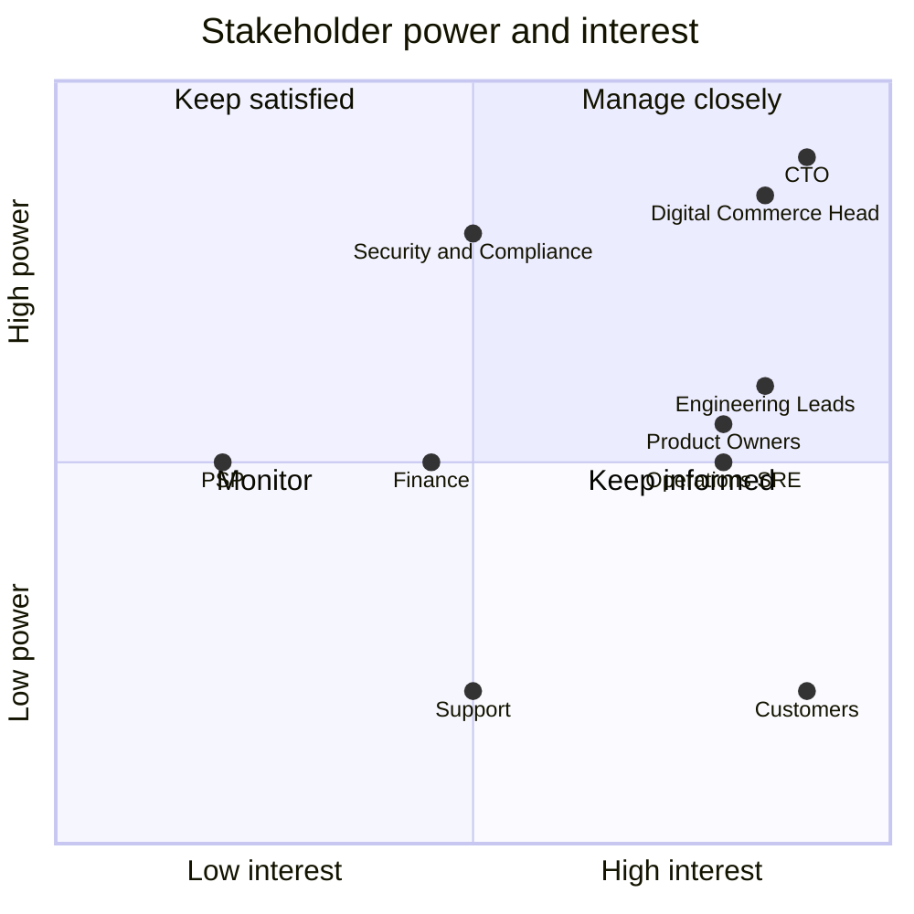

# A4: Stakeholder Map

| Field | Value |
|---|---|
| Phase | A |
| Version | 1.0 (Approved 2026-10-24) |
| Date | 2026-10-24 |
| Owner | Lead Architect |

> Role-played stakeholders for a fictional organisation. In a real engagement each row would be validated by interview.

## 1. Stakeholders and concerns

| ID | Stakeholder | Role in the work | Key concerns | Power | Interest |
|---|---|---|---|---|---|
| S-01 | Chief Technology Officer | Executive sponsor, approves vision | Outages during campaigns, cost, delivery risk | High | High |
| S-02 | Head of Digital Commerce | Business sponsor | Revenue per campaign, conversion, time to launch offers | High | High |
| S-03 | Product owners (catalogue, checkout) | Define requirements | Feature speed, ability to change independently | Medium | High |
| S-04 | Engineering leads | Build and run the platform | Complexity, tooling, clear contracts, testability | Medium | High |
| S-05 | Security and compliance officer | Reviews controls | PCI DSS scope, DPDP and GDPR, auditability, access control | High | Medium |
| S-06 | Operations / SRE lead | Runs production | Observability, alerting, recoverability, on-call load | Medium | High |
| S-07 | Finance | Funds and tracks cost | Infrastructure cost, payment reconciliation accuracy | Medium | Medium |
| S-08 | Customers | End users | Reliability at peak, correct charges, clear order status | Low (direct) | High |
| S-09 | Payment service provider | External dependency | Integration contract, volumes, security | Medium | Low |
| S-10 | Customer support | Handles issues | Accurate order history, ability to explain failures | Low | Medium |

## 2. Power and interest

## 3. Engagement approach and viewpoints

| Stakeholder | Engagement | Artefacts / viewpoint they need |
|---|---|---|
| S-01, S-02 | Manage closely: gate reviews | Vision (A3), objectives, roadmap, cost and risk summary |
| S-05 | Keep satisfied: early review of data and security views | Data classification, security architecture, threat model |
| S-03, S-04 | Manage closely: working sessions each cycle | Capability map, interface catalogue, ADRs |
| S-06 | Manage closely | Deployment view, observability design, resilience and DR |
| S-07 | Keep informed | Cost model, capacity assumptions |
| S-08, S-10 | Represent through scenarios | Flash-sale scenario, order status behaviour |
| S-09 | Monitor | Payment interface contract |

## 4. Concern to objective traceability

| Concern | Objective |
|---|---|
| Outages during campaigns | O1, O2, O6 |
| Correct charges and stock | O3 |
| Independent releases | O4 |
| Compliance and access control | O5 |
| Recovery and visibility | O6 |
| Cost of peak capacity | O1 (elastic scaling), validated in Phase D |

## Revision history

| Version | Date | Author | Change |
|---|---|---|---|
| 0.1 | 2026-10-24 | Lead Architect | First draft |
| 1.0 | 2026-10-24 | Lead Architect | Approved by sponsor and baselined |
