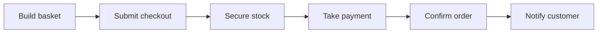

# B2: Value Streams

| Field | Value |
|---|---|
| Phase | B |
| Version | 1.0 (Approved 2026-10-24) |
| Date | 2026-10-24 |
| Owner | Lead Architect |
| Inputs | A3, A4, B1 |

## 1. Purpose
Describe how value is delivered end to end, who benefits at each stage, and which capabilities (B1) each stage needs. Value streams answer "why does this capability exist?".

## 2. Value stream catalogue

| ID | Value stream | Trigger | Value delivered | Primary stakeholder |
|---|---|---|---|---|
| VS-1 | Discover and select | Customer arrives | Customer finds the right product with confidence | S-08 Customers |
| VS-2 | Order to payment | Customer decides to buy | Customer completes a purchase and is charged correctly once | S-08, S-02 |
| VS-3 | Fulfil order | Order confirmed | Stock is committed and the order is ready for dispatch (dispatch itself is out of scope) | S-06, S-03 |
| VS-4 | Support and resolve | Customer has a question or problem | Issue explained or fixed quickly | S-08, S-10 |
| VS-5 | Run a flash sale | Business plans a campaign | Limited-stock offer sells out cleanly without outage or oversell | S-02, S-01 |

## 3. VS-2 Order to payment (core stream)

| Stage | Entry criterion | Exit criterion | Capabilities | Stakeholder value |
|---|---|---|---|---|
| Build basket | Customer selects items | Basket holds valid items and prices | CAP-03, CAP-02 | Customer controls what they buy |
| Submit checkout | Customer pays | Order recorded exactly once | CAP-04, CAP-09, CAP-10 | No duplicate orders |
| Secure stock | Order recorded | Units reserved or order rejected | CAP-06 | No oversell |
| Take payment | Stock reserved | Payment succeeded or failed | CAP-05 | Charged correctly once |
| Confirm order | Payment succeeded | Order confirmed and stock committed | CAP-04, CAP-07, CAP-06 | Customer has a firm order |
| Notify customer | Order confirmed or cancelled | Customer informed | CAP-08 | Trust through honest status |

## 4. VS-5 Run a flash sale

| Stage | What happens | Capabilities | Success measure |
|---|---|---|---|
| Plan offer | Campaign manager defines product, quantity, price, start and end, per-customer limit | CAP-01 | Offer approved |
| Prepare | Catalogue entries and stock allocation are loaded and verified, capacity is checked | CAP-01, CAP-06, CAP-12 | Readiness checklist passed |
| Go live | Offer opens, traffic spikes | CAP-02, CAP-03, CAP-04, CAP-10 | O1 and O2 hold |
| Monitor and protect | Operations watch dashboards, rate limits and scaling react | CAP-10, CAP-11 | Alert within 5 minutes of anomaly (O6) |
| Close and reconcile | Offer ends, orders drain, finance reconciles payments against orders and stock | CAP-05, CAP-06, CAP-07 | Zero oversell and zero duplicate charge (O3) |

## 5. Other streams (summary)

| Stream | Stages | Capabilities |
|---|---|---|
| VS-1 | Arrive -> browse or search -> view product -> add to basket | CAP-02, CAP-01, CAP-03 |
| VS-3 | Order confirmed -> stock committed -> ready for dispatch | CAP-06, CAP-07 |
| VS-4 | Customer asks -> agent finds order timeline -> explains or cancels -> customer informed | CAP-07, CAP-08, CAP-09 |

## 6. Value stream to capability matrix

| Capability | VS-1 | VS-2 | VS-3 | VS-4 | VS-5 |
|---|---|---|---|---|---|
| CAP-01 Catalogue | x | | | | x |
| CAP-02 Search and browse | x | x | | | x |
| CAP-03 Basket | x | x | | | x |
| CAP-04 Checkout and ordering | | x | | | x |
| CAP-05 Payment | | x | | | x |
| CAP-06 Inventory | | x | x | | x |
| CAP-07 Order management | | x | x | x | x |
| CAP-08 Notifications | | x | | x | |
| CAP-09 Identity | x | x | | x | |
| CAP-10 Edge | x | x | | | x |
| CAP-11 Observability | | | | x | x |
| CAP-12 Delivery platform | | | | | x |

CAP-04, CAP-06 and CAP-07 appear in the most critical stream (VS-2 and VS-5), which supports their priority in B1.

## 7. Business metrics (feed objectives and Phase D dashboards)

| Metric | Definition | Objective |
|---|---|---|
| Checkout success rate | Orders confirmed / checkouts submitted, excluding genuine out-of-stock | O2 |
| Time to terminal state | Submit to confirmed or cancelled, p95 | O2 |
| Oversold units | Units confirmed beyond available stock | O3 |
| Duplicate charges | Orders with more than one successful charge | O3 |
| Catalogue read latency | p95 at the edge | O1 |
| Reconciliation breaks | Payments without matching order, or the reverse | O3 |
| Time to detect | Incident start to alert | O6 |

## Revision history

| Version | Date | Author | Change |
|---|---|---|---|
| 0.1 | 2026-10-24 | Lead Architect | First draft |
| 1.0 | 2026-10-24 | Lead Architect | Approved by sponsor and baselined |
