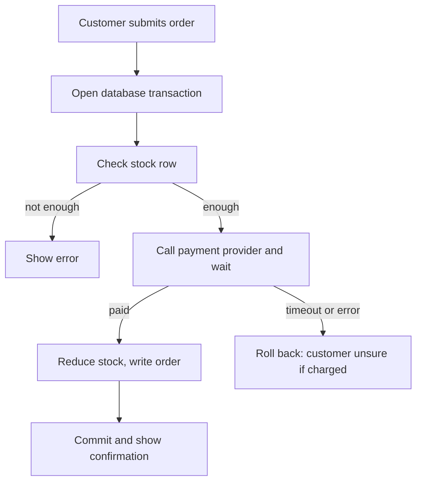
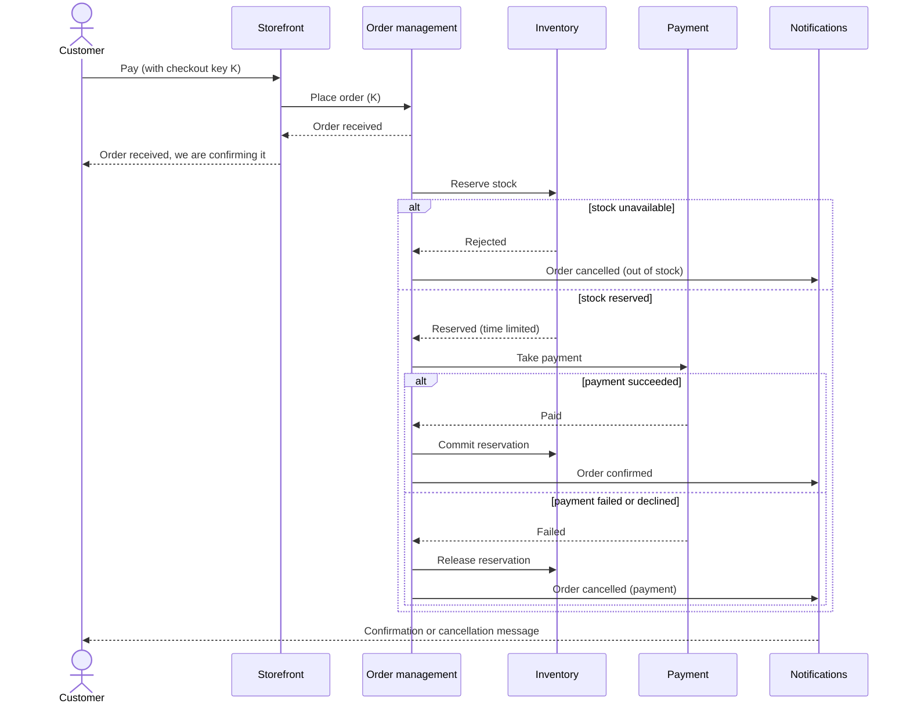
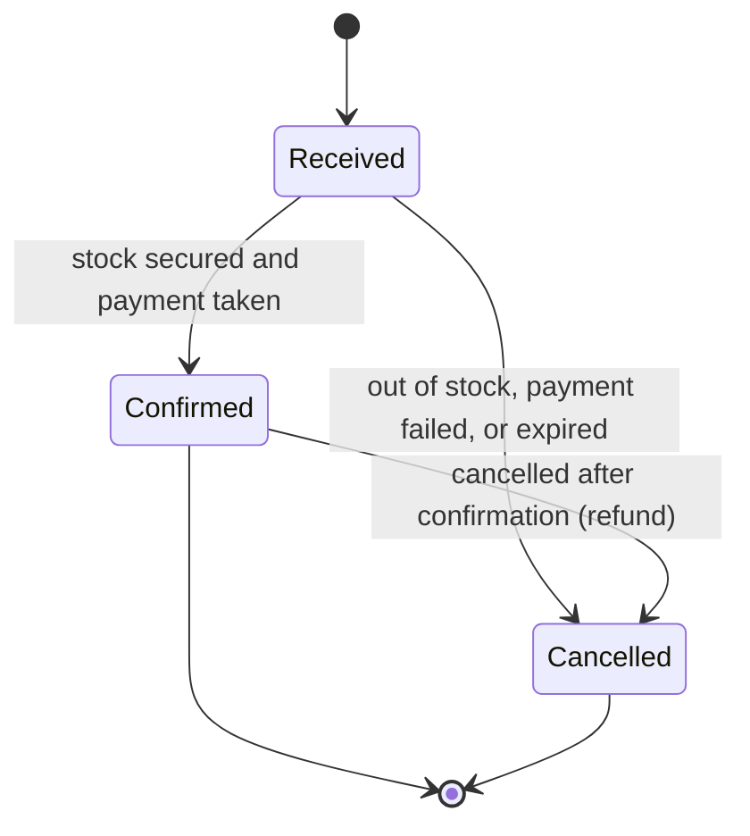

# B4: Business Process Models and Rules

| Field | Value |
|---|---|
| Phase | B |
| Version | 1.0 (Approved 2026-10-24) |
| Date | 2026-10-24 |
| Owner | Lead Architect |
| Inputs | A3 (flash-sale scenario), B2 |

> Fictional case study. Rules marked `[assumed]` are proposals. Rules marked **Confirmed** were accepted by the sponsor on 2026-10-24.

## 1. Purpose
Model the critical process (order to payment, VS-2) in the baseline and the target, make the business rules explicit, and define the honest customer-visible order states. Technical mechanisms (messages, sagas, locking) are deliberately left to Phase C.

## 2. Process catalogue

| ID | Process | Value stream | Modelled here |
|---|---|---|---|
| PRC-01 | Browse and search | VS-1 | Summary only |
| PRC-02 | Place order (checkout) | VS-2 | **Yes** |
| PRC-03 | Cancel order | VS-2, VS-4 | Rules only |
| PRC-04 | Run flash-sale offer | VS-5 | See B2 |
| PRC-05 | Reconcile payments | VS-5 | Rules only |
| PRC-06 | Explain an order to a customer | VS-4 | Requirement only |

## 3. Baseline: PRC-02 Place order in ShopStream Classic

Business problems visible in the baseline:

| # | Problem | Consequence |
|---|---|---|
| BP-1 | Stock row locked while waiting for the payment provider | Throughput collapses during a flash sale |
| BP-2 | Payment timeout leaves the outcome unknown | Possible charge with no order, support calls |
| BP-3 | Resubmission (double click, retry) creates a second order | Duplicate orders and charges |
| BP-4 | Customer sees only success or an error page | No honest intermediate status |
| BP-5 | One database transaction spans stock, payment and order | Any slow step blocks all customers |

## 4. Target: PRC-02 Place order

Improvements over the baseline: BP-1 and BP-5 are removed by taking the customer response off the critical path. BP-3 is addressed by the checkout key (BR-03). BP-4 is addressed by the explicit states in section 6. BP-2 is handled by the unknown-outcome rule (BR-10).

## 5. Exceptional paths

| Situation | Business outcome |
|---|---|
| Stock unavailable | Order cancelled, customer not charged, reason "out of stock" |
| Payment declined | Reservation released, order cancelled, reason "payment" |
| Payment outcome unknown (provider timeout) | Order stays "Received" while the outcome is checked with the provider (BR-10). Customer is never charged twice |
| Customer abandons after reserving | Reservation expires (BR-01), stock returns to sale |
| Customer retries or double-clicks | Same order returned (BR-03) |
| Platform part is down | Order accepted when possible and processed later, or politely rejected before taking payment. Never charged without an order |

## 6. Customer-visible order states

| State | Meaning shown to customer | Terminal |
|---|---|---|
| Received | "We have your order and are confirming it" | No |
| Confirmed | "Your order is confirmed" | Yes (for this scope) |
| Cancelled | "Your order was cancelled" with a reason category: out of stock, payment, expired, requested by you | Yes |

Fulfilment states after confirmation (packed, dispatched, delivered) are out of scope.

## 7. Business rules

| ID | Rule | Status |
|---|---|---|
| BR-01 | Stock reserved for an order is held for a maximum of 10 minutes, then released | **Confirmed** |
| BR-02 | An order is confirmed only after payment succeeded | Firm |
| BR-03 | Submitting the same checkout (same checkout key) never creates a second order | Firm |
| BR-04 | A customer is charged at most once per order | Firm |
| BR-05 | Cancelling an order releases its stock. If it was paid, the payment is refunded | Firm |
| BR-06 | The order price is fixed when the order is received | **Confirmed** |
| BR-07 | A flash-sale offer may set a maximum quantity per customer | **Confirmed** |
| BR-08 | Customers always see an honest status (section 6) | Firm |
| BR-09 | Orders are in a single currency, INR | **Confirmed** (India primary market) |
| BR-10 | If a payment outcome is unknown, the system checks it with the provider before deciding. It never retries a charge blindly | Firm |
| BR-11 | Only the owner or a support agent can view an order. Only the owner can request cancellation before confirmation | Firm |
| BR-12 | Every payment must reconcile to exactly one order, and every confirmed order to exactly one successful payment. Differences are reported daily | Firm |

## 8. Process requirements (extends A3 list)

| ID | Requirement | Rule | Objective |
|---|---|---|---|
| REQ-09 | A flash-sale offer can set start, end, quantity and per-customer limit | BR-07 | O2, O3 |
| REQ-10 | Reservations expire automatically | BR-01 | O3 |
| REQ-11 | Customers can request cancellation before confirmation | BR-05, BR-11 | O2 |
| REQ-12 | Finance receives a daily reconciliation report | BR-12 | O3 |
| REQ-13 | Support agents see a timeline of each order's states and reasons | BR-08, BR-11 | O6 |
| REQ-14 | Customers are notified of confirmation or cancellation | BR-08 | O2 |
| REQ-15 | Unknown payment outcomes are resolved by querying the provider | BR-10 | O3 |

## Revision history

| Version | Date | Author | Change |
|---|---|---|---|
| 0.1 | 2026-10-24 | Lead Architect | First draft |
| 0.2 | 2026-10-24 | Lead Architect | BR-01, BR-06, BR-07, BR-09 confirmed |
| 1.0 | 2026-10-24 | Lead Architect | Approved by sponsor and baselined |
