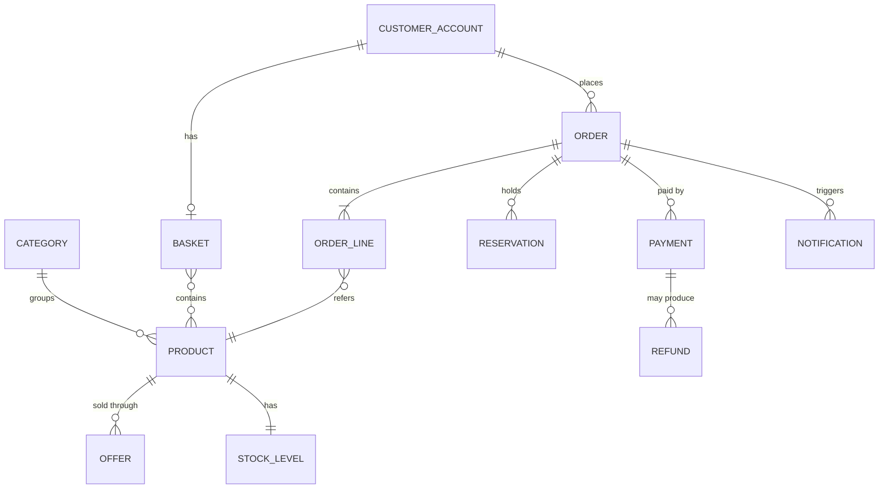

# B5: Business Information Concepts

| Field | Value |
|---|---|
| Phase | B |
| Version | 1.0 (Approved 2026-10-24) |
| Date | 2026-10-24 |
| Owner | Lead Architect |
| Inputs | B1, B4, P1 (PR-03, PR-04) |

## 1. Purpose
Name the key business concepts, state which capability owns each, and give an initial sensitivity classification. This is the bridge to Phase C (Data Architecture), where concepts become logical data entities and data stores. It is not a database design.

## 2. Concept catalogue

| Concept | Definition | Owner capability | Source of truth | Sensitivity |
|---|---|---|---|---|
| Customer account | A registered person who can order | CAP-09 | Identity | Personal |
| Product | Something that can be sold | CAP-01 | Catalogue | Public |
| Category | Grouping of products | CAP-01 | Catalogue | Public |
| Offer | Time-boxed, limited-quantity sale of a product, with optional per-customer limit | CAP-01 | Catalogue | Internal |
| Price | Amount for a product at a time | CAP-01 | Catalogue | Public |
| Basket | Items a customer intends to buy, temporary | CAP-03 | Basket | Personal (low) |
| Order | A customer's request to buy, with lines, price snapshot, and status | CAP-04 / CAP-07 | Order management | Personal |
| Order line | Product, quantity and price within an order | CAP-07 | Order management | Personal |
| Stock level | Units available for a product | CAP-06 | Inventory | Internal |
| Reservation | A time-limited hold on units for an order | CAP-06 | Inventory | Internal |
| Payment | An attempt to charge, with outcome and provider reference. Holds a provider token, never card data | CAP-05 | Payment | **Payment** (restricted) |
| Refund | Return of money for a cancelled paid order | CAP-05 | Payment | Payment (restricted) |
| Checkout key | Unique value identifying one checkout attempt, for duplicate protection | CAP-04 | Order management | Internal |
| Notification | Message sent to a customer about an order | CAP-08 | Notifications | Personal |
| Reconciliation record | Result of matching payments to orders | CAP-05 | Payment | Internal |

## 3. Sensitivity classes (initial, refined in Phase C)

| Class | Handling |
|---|---|
| Public | No restriction |
| Internal | Authenticated access only |
| Personal | Encrypted in transit and at rest, access logged, retention rule, never in logs (PR-04) |
| Payment (restricted) | Provider tokens only. Card numbers never stored or logged. Tightest access (REQ-08) |

## 4. Conceptual relationships

Reading note: relationships that cross capability owners (for example Order to Product, Order to Payment) are **references by identifier**, never shared tables (PR-03). How those references stay consistent is a Phase C topic.

## 5. Information rules carried into Phase C

| Rule | Source |
|---|---|
| The order stores a price snapshot, not a live link to the price | BR-06 |
| Stock changes only through reservations and commits | BR-01, BR-05 |
| Payment records must reconcile with orders | BR-12 |
| Personal and payment data classes drive storage and logging choices | PR-04 |

## Revision history

| Version | Date | Author | Change |
|---|---|---|---|
| 0.1 | 2026-10-24 | Lead Architect | First draft |
| 1.0 | 2026-10-24 | Lead Architect | Approved by sponsor and baselined |
