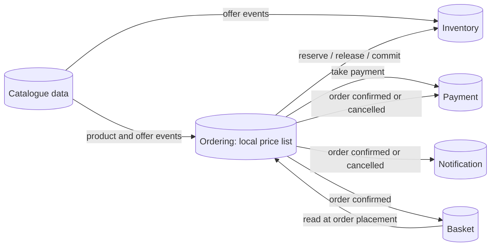

# C1: Data Architecture

| Field | Value |
|---|---|
| Phase | C (Data Architecture) |
| Version | 1.0 (Approved 2026-10-24) |
| Date | 2026-10-24 |
| Owner | Lead Architect |
| Inputs | B5 (concepts), B4 (rules), P1 (PR-03, PR-04), C3 |

> Logical architecture only. Concrete database products are chosen in Phase D.

## 1. Purpose
Turn the business concepts of B5 into logical data entities with an owner, define the kind of store each needs, set consistency and security rules, and prepare migration and multi-region readiness.

## 2. Data ownership by service

| Service | Owned entities | Key attributes (logical) |
|---|---|---|
| Catalogue | Product, Category, Offer, Price | product id, SKU (unique), name, attributes (flexible), category, price, offer window, offer quantity, per-customer limit |
| Basket | Basket, Basket item | customer id, item product id, quantity, last updated, expiry |
| Ordering | Order, Order line, Checkout key, Order history entry, Saga state, Local price list (replica) | order id, customer id, status, reason, line product id / quantity / price snapshot, total (INR), checkout key (unique per customer), timestamps |
| Inventory | Stock level, Reservation, Allocation per offer | product id, available, reserved, reservation id, order id, expiry time, state (held, committed, released) |
| Payment | Payment, Refund, Reconciliation record, Order reference (replica) | payment id, order id, provider reference (token), amount, state, attempt count, outcome |
| Notification | Notification, Delivery attempt | notification id, order id, recipient reference, type, status |
| Identity (platform) | Customer account, Roles, Credentials | managed by the identity product |

Rule (PR-03): data from another owner is only ever held as an **identifier** or as an explicitly named **replica** built from events. The replicas are listed above (Ordering's local price list, Payment's order reference).

## 3. Store requirements (store class, not product)

| Service | Access pattern | Consistency need | Store class | Notes |
|---|---|---|---|---|
| Catalogue | 95% reads, flexible attributes, paged lists | Eventual for readers, strong for single product writes | Document store | Cache in front. Keyset pagination (ADR-003) |
| Basket | High-rate small reads and writes, expiry | Per-basket atomicity | Key-value in-memory with expiry | Loss of a basket is tolerable, loss of an order is not |
| Ordering | Transactional writes, history, saga state | Strong (ACID) within the order | Relational | Unique checkout key. Outbox table in the same transaction |
| Inventory | Contended counters on hot items, expiry sweeps | Strong, no oversell | Relational with row-level control | Hot-key contention is the main design risk (section 7) |
| Payment | Idempotent writes, reconciliation queries | Strong, uniqueness of provider reference | Relational | Restricted data class |
| Notification | Append and status update | Eventual | Any simple store | Optional to persist |
| Search (optional) | Full-text queries | Eventual | Search index | Fed from Catalogue events. Out of first release |

Phase D must justify every distinct database engine (PR-02): four engines means four operational skills. Candidate rationalisation (for example one relational engine for Ordering, Inventory and Payment) is a Phase D decision.

## 4. Logical data flow

All flows between owners are messages or API reads. No shared tables.

## 5. Consistency model

| Boundary | Model | Mechanism (logical) |
|---|---|---|
| Inside one service | Strong | Local transaction |
| Order, stock, payment together | Eventual, guided by a saga | Orchestration in Ordering. Compensations: release reservation, refund |
| Publish an event with a state change | Atomic together | Outbox written in the same local transaction |
| Consume an event | At least once, safe to repeat | Consumers record processed message ids (inbox) |
| Replicas (price list, order reference) | Eventual, bounded lag | Events plus periodic resync |

The price an order is charged at is the **snapshot taken when the order is received** (BR-06), so replica lag cannot cause the charged price to change afterwards.

## 6. Identifiers and time (also prepares multi-region)

| Rule | Reason |
|---|---|
| Identifiers are globally unique and generated by the service, not by database sequences | Safe to merge or replicate across regions. No coordination needed |
| Identifiers are time-sortable where paging needs it | Supports keyset pagination |
| All timestamps are UTC | Avoids ambiguity across regions |
| Every message and record carries a correlation id | Supports tracing (CAP-11) and support timelines (REQ-13) |
| No cross-service foreign keys | PR-03 |

## 7. Hot-key contention (design risk)

A flash sale directs up to 500 orders per second at a handful of products, possibly one. Reserving stock for the same row from many concurrent requests is a classic bottleneck.

| Option | Idea | Trade-off |
|---|---|---|
| Atomic conditional decrement | One statement: reduce available only if enough remains | Simple, correct, but serialised per item |
| Pre-allocation | Split the offer quantity into slices handled by separate counters | Higher throughput, more complex, may strand a few units |
| Single-writer queue per hot item | Reservations for one item processed in order by one consumer | Natural fit with messaging, strict fairness |

Phase C requirement: Inventory must support one of these with **proof by load test in Phase D** (R-03). The choice is deferred, not forgotten.

## 8. Data classification and handling

Extends B5. Rules apply to storage, logs, messages, and backups.

| Class | Examples | At rest | In transit | Logs and messages | Access |
|---|---|---|---|---|---|
| Public | Product, price | Standard | TLS | Allowed | Open |
| Internal | Offer, stock, reservation | Standard | TLS | Allowed, no personal data | Authenticated |
| Personal | Account, order, notification | Encrypted | TLS | **Identifiers only**, no names, emails, addresses | Role based, audited |
| Payment (restricted) | Payment token, refund | Encrypted, separate store | TLS | Never card data, tokens masked | Payment service and finance only |

Events carry customer **identifiers**, not personal details. A consumer that needs an email fetches it from Identity at send time.

## 9. Retention and lifecycle

| Data | Retention (proposal `[assumed]`) | End of life |
|---|---|---|
| Orders and order history | 8 years (commercial records) | Archive, then delete |
| Payments and refunds | 8 years | Archive, then delete |
| Baskets | Expire after 30 days idle | Deleted |
| Reservations | Held up to 10 minutes (BR-01), record kept 90 days | Deleted |
| Notifications | 1 year | Deleted |
| Operational logs | 30 days searchable, 1 year archived | Deleted |
| Accounts | Until deletion requested, subject to legal retention (DPDP) | Anonymise order references |

## 10. Reporting and reconciliation

- Operational queries stay inside their owner's service.
- The daily reconciliation report (REQ-12, BR-12) is produced by Payment using its own payment records plus its replica of order outcomes.
- Cross-domain analytics, if needed later, use a separate read model fed from events. This is out of scope for the first release.

## 11. Migration of data from ShopStream Classic (outline)

| Data | Approach | Phase F detail |
|---|---|---|
| Products, categories | One-time load, then Catalogue becomes the owner | Yes |
| Customer accounts | Import into the identity product with password reset or hash migration | Yes |
| Orders and history | Load as read-only history into Ordering. In-flight orders complete in the monolith | Yes |
| Stock levels | Cut-over per product group: freeze, copy, switch owner | Yes |
| Payments | Historical records loaded for reconciliation continuity | Yes |

Strangler principle: at any time each entity has exactly one writer, either the monolith or the new owner.

## 12. Multi-region readiness (Q3 outcome)

One region with a recovery site is the target. To keep multi-region possible:
- Region-agnostic identifiers and UTC time (section 6).
- No cross-service transactions, so services can be replicated or relocated independently.
- Idempotent consumers, so replay after failover is safe.
- Data residency: personal data stays within India, so recovery site and any future second region are both in India.
- Recovery objectives from O6 (RTO 30 minutes, RPO 1 minute for orders) drive replication choices in Phase D.

## Revision history

| Version | Date | Author | Change |
|---|---|---|---|
| 0.1 | 2026-10-24 | Lead Architect | First draft |
| 1.0 | 2026-10-24 | Lead Architect | Approved by sponsor and baselined |
