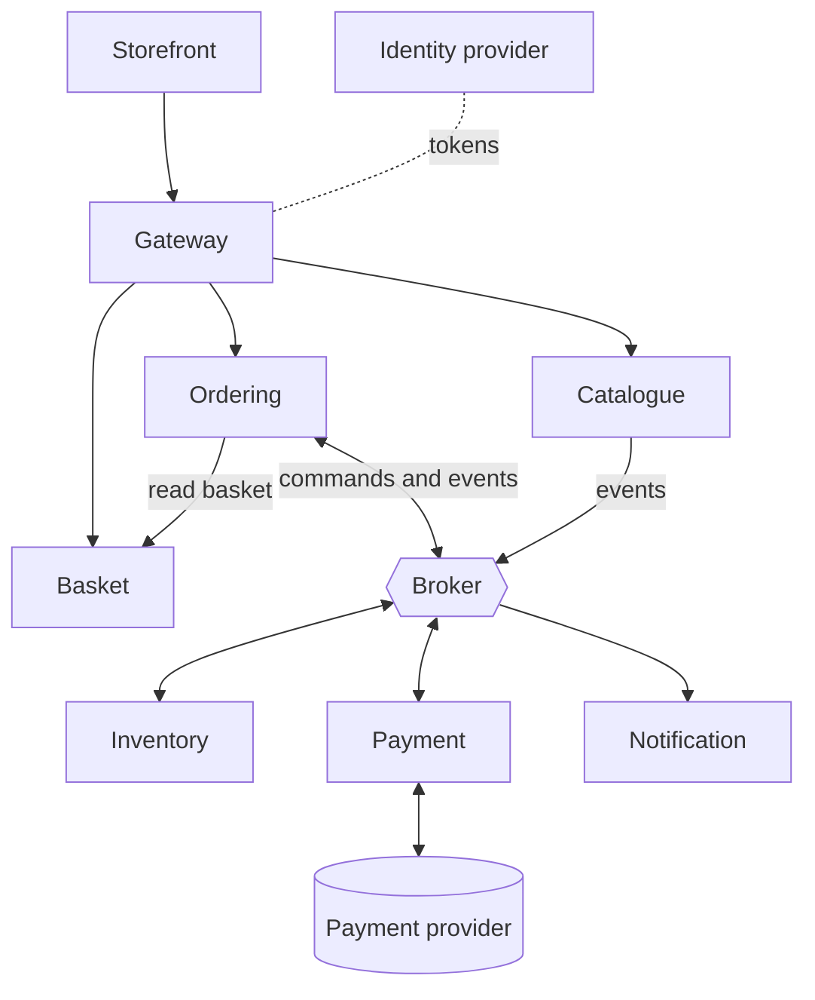

# C2: Application Architecture

| Field | Value |
|---|---|
| Phase | C (Application Architecture) |
| Version | 1.0 (Approved 2026-10-24) |
| Date | 2026-10-24 |
| Owner | Lead Architect |
| Inputs | B1, B3, B4, C1, C3 (ADR-004) |

## 1. Purpose
Define the target application portfolio, how applications map to capabilities and teams, their criticality and scaling profile, and how the system behaves when parts fail.

## 2. Baseline and target portfolio

| Baseline application | Target |
|---|---|
| ShopStream Classic (monolith) | Retired in stages via strangler migration (Phase F) |

| Target application | Type | Capability | Team | Tier |
|---|---|---|---|---|
| Storefront (web UI) | Client application | CAP-02, CAP-03, CAP-04 (UI) | T1/T2 | 2 |
| Gateway | Platform | CAP-10 | T4 | **1** |
| Identity provider | Platform (adopted product) | CAP-09 | T4 | **1** |
| Catalogue service | Domain service | CAP-01, CAP-02 | T1 | 2 |
| Basket service | Domain service | CAP-03 | T2 | 2 |
| Ordering service | Domain service, saga orchestrator | CAP-04, CAP-07 | T2 | **1** |
| Inventory service | Domain service | CAP-06 | T3 | **1** |
| Payment service | Domain service, integrates with the provider | CAP-05 | T3 | **1** |
| Notification service | Domain service | CAP-08 | T2 | 3 |
| Message broker | Platform | supports CAP-04 | T4 | **1** |
| Observability stack | Platform | CAP-11 | T4 | 2 |
| Delivery pipeline | Platform | CAP-12 | T4 | 2 |

Tier 1 is the checkout path: if it fails, the business cannot take money. Tier 1 gets the strictest availability, testing and on-call attention.

## 3. Application component view

## 4. Service responsibilities

| Service | Responsibilities | Explicitly does not |
|---|---|---|
| Catalogue | Products, categories, offers, prices. Publishes product and offer events | Hold stock quantities (Inventory) |
| Basket | Holds a customer's intended items. Expires | Decide prices (Catalogue and the order snapshot decide) |
| Ordering | Accepts checkout (idempotent), owns order and status, runs the saga, exposes order timeline | Reserve stock or touch payments directly |
| Inventory | Stock levels, reservations, expiry, per-customer limits, commit and release | Know about customers' payment or notifications |
| Payment | Takes and refunds payments with the provider, resolves unknown outcomes, reconciles | Store card data (provider tokens only) |
| Notification | Sends customer messages about order outcomes | Decide order state |
| Gateway | Authenticates, rate limits, routes, aggregates for the UI | Contain business rules |

## 5. Capability to application matrix

| Capability | Gateway | Identity | Catalogue | Basket | Ordering | Inventory | Payment | Notification | Platform |
|---|---|---|---|---|---|---|---|---|---|
| CAP-01 Catalogue | | | x | | | | | | |
| CAP-02 Search and browse | x | | x | | | | | | |
| CAP-03 Basket | | | | x | | | | | |
| CAP-04 Checkout | x | | | | x | | | | |
| CAP-05 Payment | | | | | | | x | | |
| CAP-06 Inventory | | | | | | x | | | |
| CAP-07 Order management | | | | | x | | | | |
| CAP-08 Notifications | | | | | | | | x | |
| CAP-09 Identity | | x | | | | | | | |
| CAP-10 Edge | x | | | | | | | | |
| CAP-11 Observability | | | | | | | | | x |
| CAP-12 Delivery | | | | | | | | | x |

Every capability has exactly one owning application, which is the traceability check for PR-01.

## 6. Scaling profile (from A3 numbers)

| Service | Load at peak | Scaling approach | Concern |
|---|---|---|---|
| Gateway | about 3,000 req/s | Several stateless instances, shared limiter state | Single entry point: must not be a single point of failure |
| Catalogue | about 2,850 read req/s (95%) | Stateless instances plus caching | Cache invalidation on price or offer change |
| Basket | Proportional to browsing sessions | Stateless instances, fast store | Expiry |
| Ordering | 50 orders/s peak, 500/s burst | Stateless instances, durable database | Burst absorption through the broker |
| Inventory | Same order rate, concentrated on few items | Instances scale, hot item serialised | Hot-key contention (C1 section 7) |
| Payment | Same order rate, limited by provider | Instances plus rate control to the provider | Provider limits and latency |
| Notification | Same order rate | Queue-backed workers | Can lag safely |

Message volume estimate for the burst: about 6 to 8 messages per order, so 500 orders/s is roughly 3,000 to 4,000 messages/s. To be validated in Phase D (R-03).

## 7. Behaviour when parts fail (degradation design)

| Failing component | Effect on customers | Required behaviour |
|---|---|---|
| Notification | None on the order | Messages queue and are sent later. Order flow unaffected |
| Catalogue | Browse and search degrade | Serve cached content. Checkout continues using Ordering's local price list |
| Basket | Cannot start checkout | Checkout is rejected **before** payment with a "try again" message |
| Inventory slow or down | Orders wait in Received | Orders accepted, reservation commands wait, order is cancelled without charge if not reserved within the maximum wait (proposal 2 minutes `[assumed]`) |
| Payment provider slow or down | Payment delayed | Circuit breaker, bounded retries, unknown outcome handled by BR-10. Never a blind second charge |
| Broker | New sagas cannot progress | Ordering still records accepted orders atomically with the outbox, then relays when the broker returns |
| Identity | Sign-in fails | Existing tokens remain valid until expiry |
| One service instance | None | Other instances serve. Health checks remove the failed one |
| Whole region | Outage | Recover in the recovery site within RTO 30 minutes, RPO 1 minute (O6) |

## 8. Quality attributes per tier

| Attribute | Tier 1 | Tier 2 | Tier 3 |
|---|---|---|---|
| Availability target | 99.9% or better | 99.9% | 99.5% |
| Required testing | Failure injection, load, contract | Load, contract | Contract |
| Observability | Business and technical alerts | Technical alerts | Basic |
| Deployment | Gradual rollout with rollback | Gradual rollout | Standard |

## Revision history

| Version | Date | Author | Change |
|---|---|---|---|
| 0.1 | 2026-10-24 | Lead Architect | First draft |
| 1.0 | 2026-10-24 | Lead Architect | Approved by sponsor and baselined |
