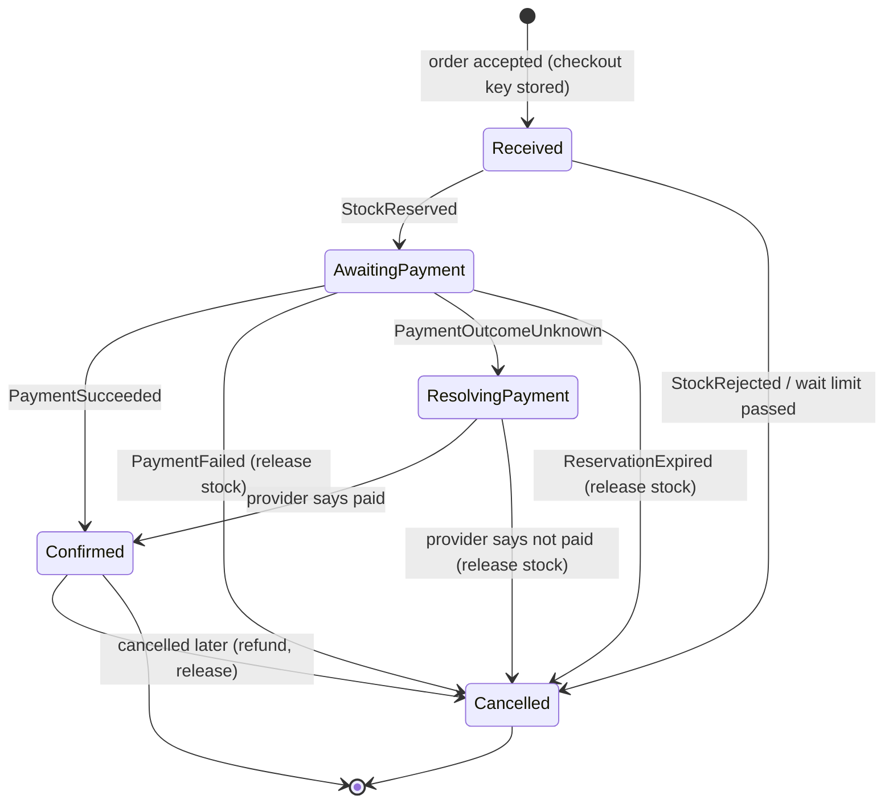

# C4: Interfaces, Events and Checkout Saga

| Field | Value |
|---|---|
| Phase | C (Application Architecture) |
| Version | 1.0 (Approved 2026-10-24) |
| Date | 2026-10-24 |
| Owner | Lead Architect |
| Inputs | B4 (process, rules), C1, C2, P1 (PR-05 to PR-08) |

> Logical contracts. Message formats and products are chosen in Phase D. Contract details (schemas) are written per service during implementation.

## 1. Purpose
Specify how applications talk to each other, which messages exist, and exactly how the checkout saga behaves, including failures. This is the most important design in the platform (CAP-04, CAP-06).

## 2. Integration style (PR-08)

| Need | Style |
|---|---|
| Queries (browse, read an order) | Synchronous request/response through the gateway |
| State changes across services | Asynchronous commands and events through the broker |
| Order placement response | Synchronous acknowledgement ("Order received"), processing continues asynchronously |
| External payment provider | Synchronous calls with timeouts, plus provider callbacks or status queries |

## 3. Interface catalogue

| ID | Provider | Consumer | Type | Purpose | Criticality |
|---|---|---|---|---|---|
| IF-01 | Catalogue | Storefront (via Gateway) | API | Browse, list (keyset paging), product detail | Tier 2 |
| IF-02 | Basket | Storefront (via Gateway) | API | Add, change, view basket | Tier 2 |
| IF-03 | Ordering | Storefront (via Gateway) | API | Place order (with checkout key), read status, request cancellation | **Tier 1** |
| IF-04 | Basket | Ordering | API (query) | Read the basket at order placement | **Tier 1** |
| IF-05 | Ordering | Support, Finance (via Gateway) | API | Order timeline and search | Tier 2 |
| IF-06 | Payment | Finance (via Gateway) | API | Reconciliation report | Tier 3 |
| IF-07 | Identity | All services and Gateway | Standard protocol | Sign-in, token issuing, token validation keys | **Tier 1** |
| IF-08 | Payment provider | Payment | External API | Authorise, capture, refund, query status | **Tier 1** |

All APIs: versioned (`/v1`), described by OpenAPI, errors as RFC 7807 problem documents, authenticated at the gateway **and** validated inside each service (PR-09).

## 4. Message catalogue (commands and events)

| Message | Kind | Sent by | Consumed by | Meaning |
|---|---|---|---|---|
| ProductPublished, PriceChanged | Event | Catalogue | Ordering (price list), Search later | Product or price available or changed |
| OfferScheduled, OfferEnded | Event | Catalogue | Inventory, Ordering | Time-boxed offer with quantity and per-customer limit |
| ReserveStock | Command | Ordering | Inventory | Hold units for an order |
| StockReserved, StockRejected | Event | Inventory | Ordering | Reservation outcome |
| ReservationExpired | Event | Inventory | Ordering | Hold lapsed (BR-01) |
| TakePayment | Command | Ordering | Payment | Charge the order amount |
| PaymentSucceeded, PaymentFailed, PaymentOutcomeUnknown | Event | Payment | Ordering | Payment outcome |
| CommitStock, ReleaseStock | Command | Ordering | Inventory | Finalise or free the hold |
| RefundPayment | Command | Ordering | Payment | Return money for a paid order that is cancelled |
| OrderConfirmed, OrderCancelled | Event | Ordering | Notification, Payment (reconciliation), Basket (clear) | Terminal outcome with reason |

Every message carries: message id (unique), correlation id, order id where relevant, UTC time, schema version. Messages contain identifiers, not personal data (C1 section 8).

## 5. Choice: orchestration, not choreography

| Aspect | Orchestration (Ordering coordinates) | Choreography (services react to each other) |
|---|---|---|
| Visibility of order state (REQ-04, REQ-13) | One place holds the state | Must be reconstructed from events |
| Compensations | Explicit steps | Scattered across services |
| Coupling | Ordering knows the steps | Services know each other's events |
| Risk | Ordering becomes complex | Hard to follow and debug |

Decision: **orchestration by the Ordering service** for the checkout. Other flows (catalogue to price list, order outcome to notification) stay event-based choreography because they are simple and one-directional.

## 6. Checkout saga state model

Customer-visible states (B4) map as: Received, AwaitingPayment and ResolvingPayment show as **Received**. Confirmed and Cancelled are shown as they are.

| Step | Trigger | Action | Compensation if later step fails |
|---|---|---|---|
| 1 | Place order accepted | Store order, saga state and outbox in one local transaction | None needed (nothing external done) |
| 2 | State Received | Send ReserveStock | ReleaseStock |
| 3 | StockReserved | Send TakePayment | RefundPayment if paid, ReleaseStock |
| 4 | PaymentSucceeded | Send CommitStock, mark Confirmed, publish OrderConfirmed | RefundPayment, ReleaseStock if commit fails permanently |
| 5 | Any failure | Mark Cancelled with reason, publish OrderCancelled | Already applied |

Time limits `[assumed]`: stock wait 2 minutes, payment attempt bounded by the reservation (BR-01, 10 minutes), unknown outcome resolved within 10 minutes with operator alert after that.

## 7. Idempotency and duplicate protection (PR-07, BR-03, BR-04)

| Where | Rule |
|---|---|
| Place order | The checkout key is unique per customer. A repeated request returns the existing order and does not start a second saga |
| Commands to Inventory and Payment | Carry the order id. Handling the same command twice has the same effect as once |
| Payment provider calls | Use an idempotency reference derived from the order id and attempt, so a retried call cannot charge twice |
| Event consumers | Remember processed message ids and skip repeats |
| Refunds | One refund per order and reason |

## 8. Known race conditions and rules

| Race | Rule |
|---|---|
| Reservation expires while payment is in flight | Payment is requested only if more than a safety margin remains. While a payment attempt is open, the reservation is extended by a bounded amount. If payment succeeds after expiry anyway, try to re-reserve, otherwise refund and cancel with a clear reason |
| Customer cancels while payment is in flight | Cancellation is accepted as a request. Ordering decides after the payment outcome is known |
| Duplicate PaymentSucceeded delivered | Ignored by the inbox rule |
| Order confirmed but notification fails | Notification retries independently. No effect on state |
| Price changes after order received | No effect (BR-06 snapshot) |

## 9. Contract rules (PR-05)

- Additive changes only within a version (new optional fields). Breaking change means new version and parallel support during transition.
- Consumer-driven contract tests run in each service's pipeline.
- Unknown fields are ignored by consumers.
- Each message and API is owned by exactly one team.

## 10. Open design decisions (carried to Phase D or later)

| # | Decision | Recommended direction |
|---|---|---|
| DD-1 | How Ordering gets prices at placement | Local price list replicated from Catalogue events, validated against the basket |
| DD-2 | Hot-item stock strategy | Choose among the three options in C1 section 7 by load test |
| DD-3 | How the UI learns of status changes | Polling first, push notifications later (Phase D) |
| DD-4 | Whether the gateway also aggregates data for the UI | Only simple aggregation. No business rules in the gateway |

## Revision history

| Version | Date | Author | Change |
|---|---|---|---|
| 0.1 | 2026-10-24 | Lead Architect | First draft |
| 1.0 | 2026-10-24 | Lead Architect | Approved by sponsor and baselined |
