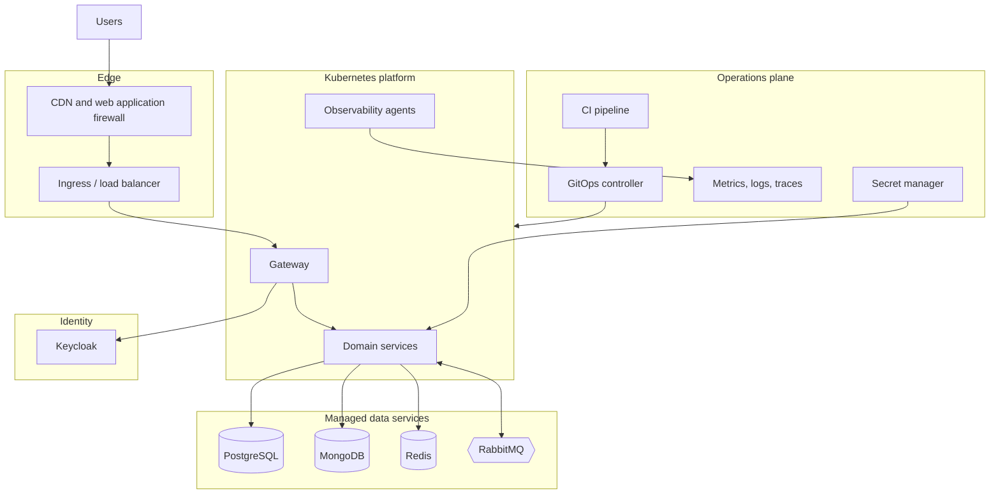
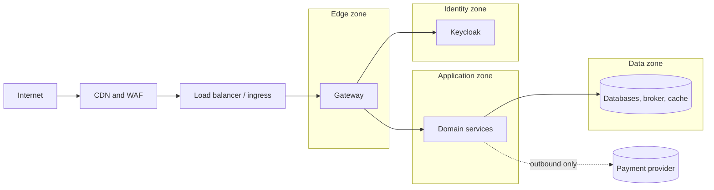

# D1: Platform Architecture and Cloud-Neutral Approach

| Field | Value |
|---|---|
| Phase | D |
| Version | 1.0 (Approved by sponsor, 2026-10-24) |
| Date | 2026-10-24 |
| Owner | Lead Architect |
| Inputs | A3 (O1 to O6), C2, C4, P1, sponsor decisions Q3 (one region plus recovery site) and Q6 (cloud-neutral) |

## 1. Purpose
Define the technology platform that hosts the application architecture, and how it stays portable across cloud providers and a self-hosted option. Product-level choices are in D2, security in D3, resilience and capacity in D4, operations in D5.

## 2. Technology principles (derived from P1)

| ID | Principle | Source |
|---|---|---|
| TP-1 | Depend on **open standards and protocols** (OCI containers, Kubernetes API, OIDC, AMQP, PostgreSQL wire protocol, Redis protocol, OpenTelemetry) rather than provider-specific services | Q6, PR-11 |
| TP-2 | Prefer **managed** versions of commodity services when they speak the same open protocol, because operating databases and brokers is not our differentiator | PR-11, PR-02 |
| TP-3 | Services are **stateless and disposable**; all state lives in named data stores | PR-06, O4 |
| TP-4 | Infrastructure is **declared as code** and reproducible; no manual changes in production | PR-10, O4 |
| TP-5 | Every component runs **at least three instances across at least two zones** when it is Tier 1 | O6 |
| TP-6 | Use supported, long-term-support versions of runtimes and products at all times | Risk R-14 (D6) |
| TP-7 | Each distinct technology must justify its operational cost | PR-02, R-13 |

## 3. Layered reference model

## 4. Cloud-neutral strategy

Portability is achieved by choosing **portable interfaces**, not by avoiding clouds. Each row states the interface we depend on and how hard it would be to move.

| Concern | Portable interface we use | Typical ways to run it | Move difficulty |
|---|---|---|---|
| Compute | OCI container images, Kubernetes API | Managed Kubernetes of any major provider, or self-run | Low |
| Relational data | PostgreSQL wire protocol and SQL | Managed PostgreSQL, or self-run with replication | Low to medium |
| Document data | MongoDB driver protocol | Provider-independent managed offering, or self-run. Compatible-but-different services exist and must be tested, not assumed | Medium |
| Cache and state | Redis protocol | Managed Redis-compatible service or self-run | Low |
| Messaging | AMQP 0-9-1 (RabbitMQ) | Self-run on Kubernetes with an operator, or a managed RabbitMQ | Low to medium |
| Identity | OpenID Connect and OAuth 2.0 | Keycloak self-run (any provider) | Low |
| Telemetry | OpenTelemetry (OTLP) | Any compatible backend | Low |
| Infrastructure definition | OpenTofu/Terraform modules with a thin provider layer | Any provider | Medium (provider modules differ) |
| Secrets | Kubernetes secrets populated by an external-secrets mechanism from a secret manager | Any secret manager | Low |
| Edge | Standard ingress, TLS, WAF and CDN capabilities | Any provider's equivalents | Medium |

**Rule:** a provider-specific service may be used only if (a) it speaks one of the protocols above, (b) an exit path is documented in an ADR, and (c) it is wrapped so application code does not change.

**Provider selection criteria** (for when a provider is chosen): two regions inside India (data residency, Q3), managed Kubernetes, managed PostgreSQL with cross-region replication, a managed or supportable RabbitMQ and MongoDB option, a WAF/CDN, price, and support. No provider is selected in this document.

## 5. Platform topology

| Element | Design |
|---|---|
| Regions | Primary region plus recovery region, both in India (Q3) |
| Zones | Primary region spans at least **three availability zones** |
| Clusters | One production cluster per region. A separate non-production cluster for dev and staging |
| Namespaces | One per team-owned domain (discovery, checkout, fulfilment-payments) plus `platform` and `observability` |
| Node pools | General pool for services, a separate pool for the gateway, so edge load cannot starve services |
| Data stores | Outside the cluster as managed services where possible (TP-2), reachable only from the cluster network |
| Ingress | One ingress controller behind a cloud-neutral load balancer, TLS terminated there |
| Network policy | Default deny. Each service allows only the traffic in C2 and C4 |
| Autoscaling | Horizontal pod autoscaling per service, node autoscaling for the cluster, **pre-scaling before planned flash sales** (VS-5 "Prepare") |

## 6. Network and trust zones

Only the gateway is reachable from the internet. Services are never exposed directly. Outbound traffic to the payment provider goes through a controlled egress path.

## 7. Environments

| Environment | Purpose | Data | Scale |
|---|---|---|---|
| Local | Developer machine, containers for dependencies | Synthetic | Minimal |
| Dev | Integration of changes, automatic deploy from the main branch | Synthetic | Small |
| Staging | Production-like. Load, failure and recovery tests (D4) | Synthetic at production volume, no real personal data | Production shape at reduced node count, scaled up for tests |
| Production | Live trading | Real | Full |
| Recovery | Warm standby in the second region (D4) | Replicated | Reduced until failover |

No real personal data is used outside production (PR-04).

## 8. Operating model touchpoints
- Platform team (T4) owns clusters, ingress, gateway, identity, broker, observability and pipelines.
- Service teams own their services' manifests, dashboards, alerts and on-call runbooks (B3).

## Revision history

| Version | Date | Author | Change |
|---|---|---|---|
| 0.1 | 2026-10-24 | Lead Architect | First draft |
| 1.0 | 2026-10-24 | Lead Architect | Approved by sponsor |
