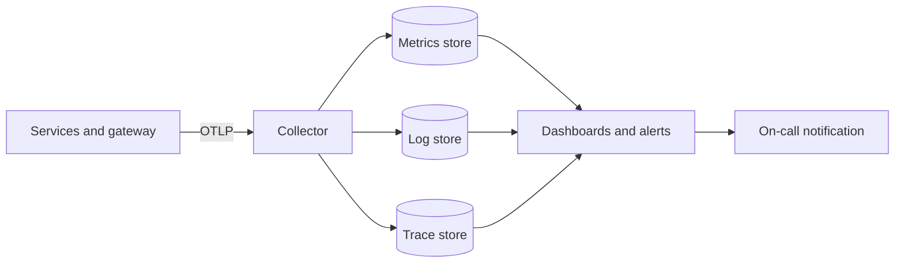
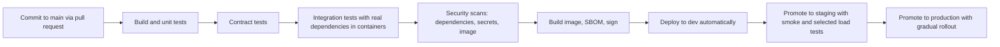

# D5: Observability and Delivery Architecture

| Field | Value |
|---|---|
| Phase | D |
| Version | 1.0 (Approved by sponsor, 2026-10-24) |
| Date | 2026-10-24 |
| Owner | Lead Architect |
| Inputs | B2 (business metrics), C1, C4, D1 to D4, objectives O4 and O6, P1 (PR-10) |

## 1. Purpose
Define how we see the system (observability) and how changes reach production safely and quickly (delivery). Together they deliver O4 (independent, frequent delivery) and O6 (detect fast, recover fast).

## 2. Observability architecture

### 2.1 Three signals, one standard
All services emit logs, metrics and traces with OpenTelemetry (TS-12) to a collector, which forwards to the backends (TS-13). Backends can change without touching services.

| Rule | Detail |
|---|---|
| Correlation | W3C trace context propagated in HTTP headers **and** in message headers, so one order is traceable across services and the broker (REQ-24) |
| Logging | Structured, with trace id, order id, service, version. **No personal or payment data** (REQ-20). Log level controlled by configuration |
| Metrics | Standard request rate, error rate, duration for every service, plus business metrics below. Keep label values bounded (no user ids as labels) |
| Traces | Sampling: keep all errors and slow traces, a small percentage of normal traces |
| Retention | Searchable logs 30 days, archived 1 year (C1 section 9) |

### 2.2 Service level objectives (SLOs) `[assumed]`

| SLI | SLO | Tier | Objective |
|---|---|---|---|
| Catalogue read availability | 99.9% of requests succeed per month | 2 | O6 |
| Catalogue read latency | 95% within 200 ms at the edge | 2 | O1 |
| Place-order acceptance | 99.9% of valid attempts accepted (excluding deliberate 429 and out-of-stock) | 1 | O2, O6 |
| Place-order latency | 95% within 800 ms | 1 | O2 |
| Time to terminal state | 95% within 30 s in normal load | 1 | O2 |
| Payment correctness | 0 duplicate charges, 0 unmatched payments | 1 | O3 |
| Stock correctness | 0 oversold units | 1 | O3 |

99.9% monthly availability allows about 43 minutes of failed requests per month. Error budgets drive release pace: when a Tier 1 budget is nearly spent, risky changes pause.

### 2.3 Alerting policy

Alerts must be actionable. Page only for customer or money impact; everything else is a ticket.

| Alert | Trigger | Action | Page? |
|---|---|---|---|
| Error budget burn (fast) | High burn over short and long windows together | Investigate and mitigate | Yes |
| Oversold unit | Count above zero | Stop offer, investigate | Yes |
| Duplicate charge | Count above zero | Stop payments, investigate | Yes |
| Saga stuck | Orders in Received or resolving longer than 10 minutes | Run resolution tooling | Yes |
| Outbox age | Oldest unsent event over 1 minute | Check relay and broker | Yes (Tier 1) |
| Replication lag | Over 30 s | Check replica, RPO at risk | Yes |
| Dead-letter queue growth | Any growth on Tier 1 queues | Inspect and replay | Ticket, page if sustained |
| Reconciliation break | Daily report differences | Finance and Payment team review | Ticket |
| Rate-limit spike | Sudden rise of 429s | Check attack or misconfiguration | Ticket, page if combined with errors |
| Certificate or secret expiry | Within 14 days | Rotate | Ticket |

### 2.4 Dashboards
1. **Edge:** requests, 429s, latency, errors by route.
2. **Order funnel:** received, reserved, paid, confirmed, cancelled by reason, time in each state. This is the business heartbeat (B2 metrics).
3. **Per service:** rate, errors, duration, saturation, dependency health.
4. **Broker and data:** queue depth and age, consumer lag, replication lag, connection pools.
5. **Flash-sale readiness:** pre-scale status, cache warm status, payment provider health, stock remaining.

## 3. Delivery architecture

### 3.1 Principles
Trunk-based development, small changes, one pipeline per service, everything as code, the same artefact promoted through environments, and releases that can be undone quickly.

### 3.2 Pipeline stages (per service)

| Stage | Requirement |
|---|---|
| Pull request | Review required. Pipeline must pass before merge |
| Contract tests | Consumer-driven tests against providers' contracts (REQ-22). A breaking change cannot merge |
| Security | Fails on critical vulnerabilities and detected secrets (REQ-28) |
| Image | Signed. Production admits only signed images |
| Promotion | GitOps: the desired state is in Git, the controller applies it (TS-16). Rollback is a Git revert |
| Production rollout | **Tier 1: canary** (small share of traffic, automatic rollback if SLO indicators degrade). Tier 2 and 3: rolling |
| Path filters | A change to one service runs only that service's pipeline, so teams do not block each other (O4, REQ-06) |

### 3.3 Database changes
- Each service owns and versions its schema (PR-03).
- **Expand and contract:** add new structures first, deploy code that works with old and new, migrate data, then remove old structures in a later release. Migrations run as a controlled step before the new version receives traffic and never lock hot tables for long (REQ-33).
- Messages and APIs follow the same additive rule (C4 section 9).

### 3.4 Configuration, secrets, and environments
- Configuration is versioned and environment-specific, kept apart from images.
- Secrets come from the secret manager at runtime (REQ-27).
- Environments are created from the same infrastructure code (REQ-34), so staging is truly production-shaped.

### 3.5 Release governance for peak events
- **Change freeze for Tier 1** from 24 hours before a planned flash sale until it closes `[assumed]`, except fixes approved by the incident lead.
- **Readiness checklist (VS-5 "Prepare"):** pre-scale done, caches warmed, provider limit confirmed against offer size (D4 section 2.3), dashboards green, on-call confirmed, rollback tested.

### 3.6 Delivery metrics (objective O4)

| Metric | Target |
|---|---|
| Lead time from merge to production | At most 1 day |
| Deployment frequency per service | At least weekly in steady state |
| Change failure rate | Under 15% `[assumed]` |
| Time to restore | Under 1 hour for Tier 1, within the 30-minute recovery target for disaster |

## 4. Operational readiness for each service (definition of done)

A service may go live only with: health endpoints, dashboards, SLOs and alerts, runbook, on-call owner, load-test evidence, threat-model review, data-class declaration, contract tests, and rollback proven.

## 5. Cost awareness
Cost is tracked per environment and per team. Pre-scaling is time-boxed and scaled back after events. Budget alerts are set for non-production clusters, which are scaled down outside working hours.

## Revision history

| Version | Date | Author | Change |
|---|---|---|---|
| 0.1 | 2026-10-24 | Lead Architect | First draft |
| 1.0 | 2026-10-24 | Lead Architect | Approved by sponsor |
