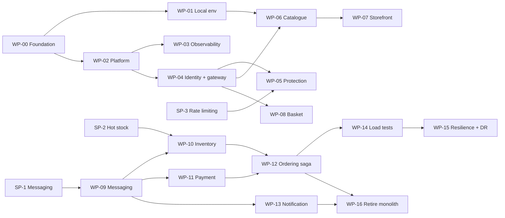

# E1: Work Packages and Spike Charters

| Field | Value |
|---|---|
| Phase | E |
| Version | 1.0 (Approved by sponsor, 2026-10-24) |
| Date | 2026-10-24 |
| Owner | Lead Architect |
| Inputs | A3 objectives O1 to O6, B6 and C5 gaps, C5 section 5 (waves), D2, D4 (tests T-1 to T-8), D5, D6 (GT-1 to GT-x, REQ-01 to REQ-35, hand-off section 7), ADR-001 to ADR-008 |

## 1. Purpose

Phase E turns the target architecture into **deliverable work packages**, decides which uncertainties need a **spike** before commitment, and proposes the **transition architectures** (stable intermediate states). Sequencing and cut-over detail belong to Phase F.

Two things shape this phase:
- Teams T1 to T4 in B3 are roles. On this project one person (the sponsor) plays all four. Work packages are therefore small, independently testable and ordered so that something useful works after each one.
- Effort sizes below are **relative** (S, M, L, XL) and carry no calendar promise. They are assumptions to be replaced by actuals (A-10 style).

## 2. Work packages

Teams: T1 Discovery, T2 Checkout and Orders, T3 Inventory and Payments, T4 Platform.

| ID | Work package | Team | Delivers | Closes gaps / meets | Size | Depends on |
|---|---|---|---|---|---|---|
| WP-00 | Foundation reset | T4 | Retarget spike to .NET 10, central package versions, solution layout, CI build and test on every push, repo published to GitHub | GT-1, I-03, REQ-35 | S | none |
| WP-01 | Local environment | T4 | Docker Compose stack (guide in `docs/guides`), seed data, one-command start | PR-10 | S | WP-00 |
| WP-02 | Platform skeleton | T4 | Local Kubernetes cluster, GitOps layout, OpenTofu baseline, secret handling, image build, scan, sign and SBOM | REQ-27, 28, 29, 34 | L | WP-00 |
| WP-03 | Observability baseline | T4 | OpenTelemetry in the service template, Prometheus, Grafana, Loki, Tempo, first dashboards and SLO definitions | REQ-32 | M | WP-02 |
| WP-04 | Identity and gateway | T4 | Keycloak realm, YARP gateway as BFF (ADR-008), token validation in services, scopes per D3 | REQ-05, 26; ADR-002, 008 | L | WP-02 |
| WP-05 | Gateway protection | T4 | Rate limits and admission control per D4 section 4, 429 with Retry-After, safe fallback if the counter store fails | REQ-25 | M | WP-04, SP-3 |
| WP-06 | Catalogue service | T1 | Catalogue API on MongoDB with keyset paging (ADR-003), search/browse, cache, offer scheduling | Wave 1, REQ-01, REQ-22 | M | WP-01, WP-04 |
| WP-07 | Web storefront | T1 | React UI for browse, sign-in through the gateway, basket and checkout screens (grows with later packages) | O1, O4 | L | WP-06 |
| WP-08 | Basket service | T2 | Redis-backed basket, expiry, price display, removes session coupling | Wave 2 | S | WP-04 |
| WP-09 | Messaging foundation | T4 | RabbitMQ quorum queues, messaging port, outbox/inbox, retry and dead-letter policy | REQ-17, 18; ADR-007 | M | SP-1 |
| WP-10 | Inventory service | T3 | Reservation, release, commit, per-customer limit on PostgreSQL, hot-item strategy from SP-2 | Wave 3, REQ-23, BR-02 | L | WP-09, SP-2 |
| WP-11 | Payment service | T3 | Provider adapter (simulated PSP), idempotent charge, ledger, unknown-outcome resolution | Wave 3, BR-09 to BR-12 | L | WP-09 |
| WP-12 | Ordering and checkout saga | T2 | Order aggregate, saga states, price snapshot, DD-5 price-change confirmation, idempotent checkout key | Wave 3, REQ-09 to 19 | XL | WP-10, WP-11 |
| WP-13 | Notification service | T2 | Event consumers, templates, delivery tracking | Wave 4 | S | WP-09 |
| WP-14 | Load-test programme | T4 | k6 scenarios T-1 to T-8, staging data, pass/fail reports | REQ-30 | M | WP-12 |
| WP-15 | Resilience and recovery build | T4 | Failure injection F-1 to F-9, warm-standby recovery environment, drill runbook | REQ-31 | L | WP-14 |
| WP-16 | Monolith retirement (simulated) | T4 | "ShopStream Classic" strangler routing removed, data migrated, legacy switched off | Wave 4 | M | WP-12, WP-13 |

The fictional baseline (ShopStream Classic) is not built as code. WP-16 is documented and rehearsed on paper, because building a fake monolith adds no learning value. This is a deliberate scope decision (see decision 3 in section 7).

## 3. Spike charters

A spike answers one question, has a time box, produces a decision input and is then thrown away or folded into a work package. Spike code lives under `spikes/` and is not production code.

### SP-1: Messaging library (closes OD-1 risk R-15)

| Item | Content |
|---|---|
| Question | Does MassTransit v8 on .NET 10 with RabbitMQ deliver outbox, inbox, retry and the Ordering saga well enough, or do we switch to a free alternative? |
| Time box | 3 working days |
| Method | Build the smallest saga (Received, AwaitingPayment, Confirmed or Cancelled) with the outbox on PostgreSQL. Run it against the C4 saga rules. Inject duplicate and out-of-order messages (T-8 style). Check package compatibility with .NET 10 and the current v8 patch level |
| Pass criteria | Builds and runs on .NET 10 without forks or unsupported hacks. Duplicate delivery gives one effect. Crash between database commit and publish loses nothing (outbox). Saga state survives a restart. Throughput at least 500 msg/s on the developer machine as a smoke check only (real figures come from T-3) |
| Fail triggers | Incompatibility with .NET 10, unfixed defects in saga or outbox, or effort to work around it exceeds the time box |
| Fallback | Free alternative chosen by a second one-day check of one open-source library, else thin in-house layer on the RabbitMQ client behind the same port |
| Output | Decision note appended to ADR-007, port interface, test suite reusable against any implementation |

### SP-2: Hot-item stock strategy (risk R-11, REQ-23)

| Item | Content |
|---|---|
| Question | Which method keeps one very popular product from capping the order rate at 500 orders/s while never overselling? |
| Time box | 4 working days |
| Candidates | A. Single row with atomic conditional update. B. Stock split into N buckets, reservations spread across buckets. C. Redis counter in front, PostgreSQL as the record, reconciled. D. Queue-based serialisation per product |
| Method | Same test on each: 500 reservation attempts/s on one product with limited stock for 5 minutes on a developer-scale database, measured as relative throughput, p95 latency, contention waits and correctness (final stock equals starting stock minus commits) |
| Pass criteria | Zero oversold units in every run. Chosen method sustains at least the per-instance figure assumed in D4 for Inventory, or the assumption is revised through change control |
| Output | Chosen strategy recorded as ADR-009, with its failure behaviour (what happens on Redis loss for C, bucket imbalance for B) |

### SP-3: Gateway rate limiting and admission (REQ-25)

| Item | Content |
|---|---|
| Question | Can YARP with ASP.NET Core rate limiting plus a shared counter store enforce per-client limits and the global checkout admission limit, and degrade safely when the store is down? |
| Time box | 2 working days |
| Method | Implement fixed-window, sliding-window and token-bucket policies for the D4 table. Test with several gateway instances sharing a Redis-compatible counter. Kill the counter store during load |
| Pass criteria | Limits hold within a small tolerance across instances. Excess gets 429 with Retry-After in under 20 ms (assumption). With the store down the gateway falls back to local limits and does not fail open on checkout |
| Output | Policy design and configuration notes feeding WP-05; any library gap logged as a risk |

### Spike order

SP-3 and SP-1 first (they unblock WP-05 and WP-09), SP-2 before WP-10. SP-1 needs only WP-00 and WP-01, so it can begin right after the local environment exists.

## 4. Transition architectures

Each is a stable, demonstrable state. A transition architecture is the real unit of progress: if work stops after any one of them, the system still works.

| TA | State after | Packages complete | What works | Objectives touched |
|---|---|---|---|---|
| TA-0 | Foundation | WP-00, 01 | Builds in CI, stack runs locally, repo public | O4 |
| TA-1 | Platform and edge | WP-02 to 05 | Cluster, pipeline, observability, sign-in through the gateway, limits enforced | O1, O4, O5 |
| TA-2 | Browse | WP-06, 07 | Catalogue served by the new service through the gateway with the React storefront | O1 |
| TA-3 | Basket | WP-08 | Basket moves out of server sessions | O1 |
| TA-4 | Order path | WP-09 to 12 | End-to-end checkout saga with reservation and payment, price-change confirmation | O2, O3 |
| TA-5 | Complete | WP-13, 16 | Notifications, monolith retired on paper | O6 |
| TA-6 | Proven | WP-14, 15 | T-1 to T-8 pass, recovery drill done | O1, O2, O3, O6 |

TA-0 to TA-2 are the first useful milestone. A reasonable first stopping point for interview talking points is TA-2: architecture, security, gateway, observability and a working React UI.

## 5. Traceability: requirements to packages

| Requirement group | Packages |
|---|---|
| REQ-01 to 08 (Vision) | WP-04, 05, 06, 07 |
| REQ-09 to 15 (business rules) | WP-10, 11, 12 |
| REQ-16 to 24 (information systems) | WP-06, 09, 10, 12 |
| REQ-25 to 29 (edge, security) | WP-02, 04, 05 |
| REQ-30, 31 (verification) | WP-14, 15 |
| REQ-32 to 35 (operate, deliver) | WP-00, 02, 03 |

Every REQ has at least one package. Gaps found when Phase F and G review will be logged in the requirements register.

## 6. Risks and assumptions added

| ID | Type | Statement | Response |
|---|---|---|---|
| R-18 | Risk | One person plays four teams, so work packages serialise and the plan stretches | Small packages, transition architectures as stopping points, TA-2 as first milestone |
| R-19 | Risk | Learning stack (Kubernetes, Keycloak, OpenTofu) consumes time before any business feature | Keep WP-02 minimal (local cluster), time-box, use templates |
| A-11 | Assumption | Relative sizes S to XL are unmeasured | Replace with actuals after TA-0 and TA-1 |
| A-12 | Assumption | A simulated payment provider is sufficient for the project | Interface follows real PSP semantics (BR-09 to BR-12) so a real sandbox can replace it |

## 7. Decisions requested from the sponsor

| # | Decision | Recommendation |
|---|---|---|
| 1 | Approve the package list and dependencies (section 2) | **Approved** |
| 2 | Approve the three spikes and time boxes (section 3) | **Approved.** Start with SP-3 and SP-1 |
| 3 | The monolith (ShopStream Classic) stays fictional: its retirement is documented, not coded | **Confirmed** |
| 4 | Approve TA-0 to TA-6 as the planning milestones and TA-2 as the first stopping point | **Approved** |

## Revision history

| Version | Date | Author | Change |
|---|---|---|---|
| 0.1 | 2026-10-24 | Lead Architect | First draft |
| 1.0 | 2026-10-24 | Lead Architect | Approved by sponsor |
